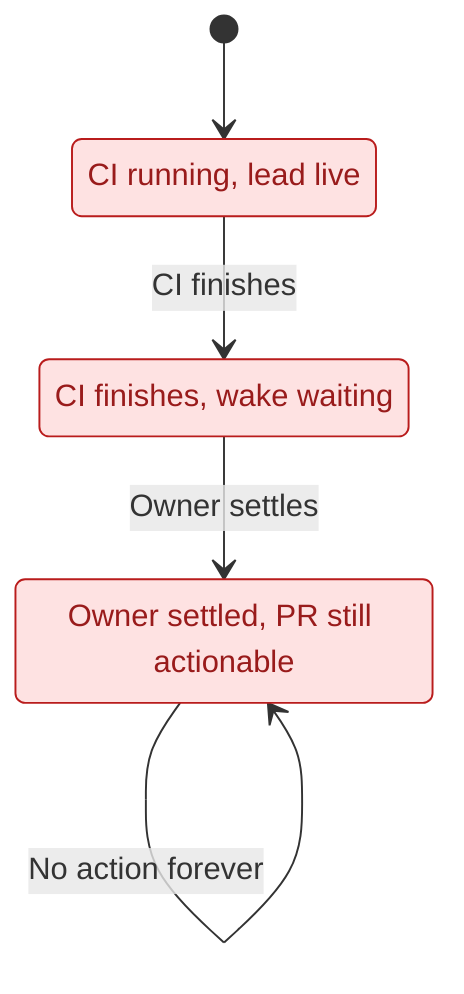
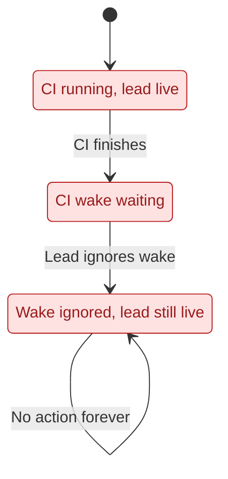
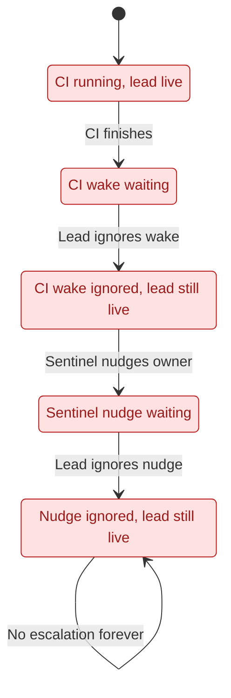
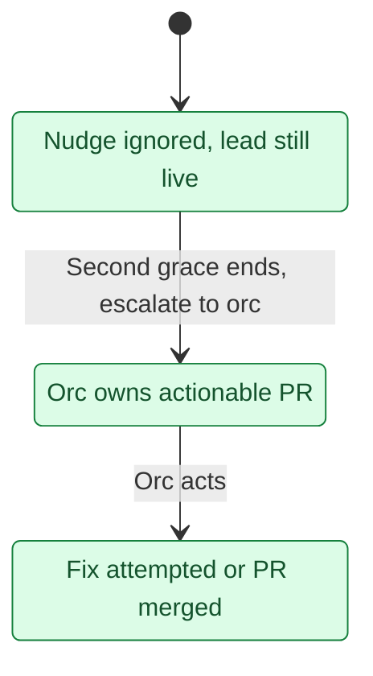

# LeadWait counterexamples

These path excerpts come from pstack `/statechart` on all six source-aligned configs,
using TLC2 2.19 / tla2tools 1.7.4 and terminal deadlock checking disabled. Each arrow
is one reported action. The red states form the violating paths; the final state
repeats forever. Normal fix, merge, hold and handoff branches are omitted here.
Use `/statechart` for the complete reachable graph when changing the model.

## Today and SettleWithoutHandoff

Both reports give the same shortest path (steps 0–2):

Noticed breaks: an actionable PR never gets fixed, merged or held.
[#1054's handoff rule](https://github.com/EtanHey/golems/pull/1054) prevents losing
ownership when settling; its end-turn rule provides the other compliance route.

## WakeIgnored

The report's shortest path (steps 0–2):

Noticed breaks without settling. [#1054's end-turn and visible-hold rules](https://github.com/EtanHey/golems/pull/1054)
address this path when followed. [#1062](https://github.com/EtanHey/golems/pull/1062)
adds draft-first review and checking that an inner-loop draft has a live worker;
it does not supply a missing sentinel transition.

## SentinelOnly: historical source bug, fixed by the second grace

PR A's report gave this shortest path (steps 0–4), retained as regression history:

Noticed breaks. [#1056](https://github.com/EtanHey/golems/pull/1056)'s final code
nudges a live lead only once and sweeps only orphans. It **does not fix this path**;
the [second-grace rule](../../../scripts/pr-sentinel/README.md) now supplies that fix.
See the [source reproduction](README.md#regression-history-a-live-lead-ignores-the-sentinel).

The current `/statechart` run passes SentinelOnly. The formerly stuck state has a
route to action (the model abstracts the two-hour delay):

RulesFollowed, SentinelOnly and RulesAndSentinel pass under their fairness assumptions; TypeOK
holds in every config. These diagrams prove neither real watch delivery nor a
bounded escalation time. The model has one PR and assumes trusted, live orc.
