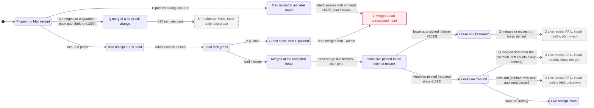

# MergeReceipts bug paths

pstack `/statechart` drew these paths from the violating configs (TLC2 2.19, tla2tools 1.7.4).
Each config reaches more than the 500-state chart budget, so `/statechart` draws only bug paths. This
chart merges those paths into one picture. Every numbered state breaks a property. Red marks a path
today's master can still take; grey dashed marks a path a landed fix has closed. Each numbered state
lists its config and its fix below. Normal review and CI steps, P's own rows and Q's own receipts are left out.

1. **ReceiptMatchesMerge**, two routes. `TodayMerge` (**current finding**, no fix yet): the lead saw
   green at H1, P pushed H2, and `gh pr merge --merge --admin` merged H2. The proposed fix is
   `--match-head-commit <the head seen green>`. `NoHeadBound` (a mutant): with no
   `verdict.head !== head` check, a receipt read at H1 passes H2's check. The head binding comes from
   [#689](https://github.com/EtanHey/golems/pull/689).
2. **LiveReceiptIsolated**, `TodayLive` before #1092: #1007's run 1. The lease went to
   [#1083](https://github.com/EtanHey/golems/pull/1083)'s branch, which moved and merged mid-receipt.
   [#1084](https://github.com/EtanHey/golems/pull/1084) documented `--lease-pr`, but the code still
   auto-picked a lease when that flag was omitted. Fixed by
   [#1092](https://github.com/EtanHey/golems/pull/1092) (merge `10cd7c56`), which makes `--lease-pr`
   required; `TodayLive` now passes.
3. **LiveReceiptIsolated**, `Pre1063`: drift counted every master commit. Fixed by
   [#1063](https://github.com/EtanHey/golems/pull/1063).
4. **LiveReceiptIsolated**, `FX16`: #1063's ` behind=` field met the end-anchored parser. Fixed by
   [#1071](https://github.com/EtanHey/golems/pull/1071).
5. **NoFalseFresh**, `TodayFresh` before #1097: a hook's skill root such as
   `skills/golem-powers/model-pin-gate/` was outside `guarded-paths.sh`. Fixed by
   [#1097](https://github.com/EtanHey/golems/pull/1097) (merge `ba06e290`), which guards every
   `hookDriftPaths()` dir; `TodayFresh` now passes. `NoGraceBound` (a mutant) still reaches the same
   state by removing the age check that came with [#1032](https://github.com/EtanHey/golems/pull/1032).

`AllFixes` passes all three properties (15,888 states). The chart proves no timing: "120 minutes
pass" is one step.
