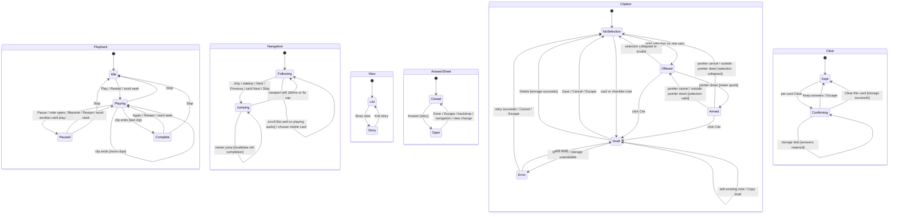

# Decision-flow control statechart

The test oracle in `decision-flow-controls.test.mjs` models three cards with two
clips each. It generates 12 seeded paths of 100 enabled transitions (six mouse,
six coarse-touch), checks both Cite buttons against selection, Armed, modal and
pointer state after every step, and requires all 35 event types in each pointer
mode. Pointerdown captures a quote, selection dismissal retains it, and cancel
or an outside press disarms it. Four runtime mutation controls must fail in the
generator: missing touch Cite, missing floating Cite, ignored armed quotes, and
Cite offered over an open note. A transient browser-restored background range
probes the dialog guard before the range clears. A failed path
prints its seed and event sequence. Happy DOM replaces media playback and the
clock; this checks control logic, not codecs, audible output, native iOS callouts,
or an exhaustive product of all states. Chromium covers layout and touch taps.

State is the parallel product of the following focused machines. Current card is
one index shared by controller, chip, sidebar and playback. Each card retains its
own clip index and idle/playing/paused/complete state. Only the current card can
play. Navigation hands off playback when playing and otherwise preserves pauses.

Speed is an independent persisted choice from 0.8, 1, 1.25, 1.5, 1.75 and 2;
changing it updates every clip. Unknown stored values fall back to 1.

Sheet entry makes the background inert and focuses its first answer. Sheet exit
restores focus when requested. A nested note temporarily owns modal semantics,
traps focus, and returns to its opener. Mouse Cite floats near the selection;
touch Cite is in the controller, or the sheet header while the controller is
inert. A noncollapsed selection never seeks, including an uncitable cross-card
selection. Clicking words without a selection seeks; arrows and Enter offer
keyboard seeking. Selecting only a speaker label offers no citation.

Stop pauses media, resets clip/time/highlights, and leaves no playing marker.
A delayed Skip cannot undo a subsequent move. At most one card and one audio clip
play, and current card agrees on every navigation surface after every event.
Clear never changes another card, preferences, or navigation. Only picks, free
text or a completed nonempty checklist answer a card; notes alone never do.

Generated paths cover control ordering. Focus wrapping, storage failures and
rollback, pick/check/free persistence, export, terminal Next/Skip, play rejection,
AbortError, modal editing/deletion, and restored partial rings have dedicated
interaction tests in `decision-flow-interactions.test.mjs`. Real-browser tests
cover selection/tap, word drag, bottom scroll and far-chip scroll settling.
