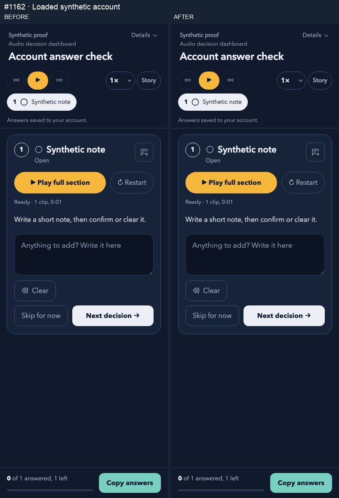

# PR 1162: synthetic Chromium proof

Real Chromium page rendered by the shared decision-flow renderer; isolated synthetic bridge, fake clock and memory-only confirmed-account backend. No real account requests, audio playback or deployment.

Before source commit: `4f676fe2bd94900a2295522e42060363fa0d2135`.
After source commit: `dbca13d8cb8e1ebcc740b06802b865b8b8e04ce0` (product code, before adding this proof-only commit).
Renderer SHA-256: `d36bd1a8854a83a1ebec4e9002c724cb8446291a24ad38ee68b4870ebd7d179a`.
Before trimmed installer SHA-256: `161172a87a6e1f852f524f22f8b356ac6d101a2f0d93427e1988812807ff1018`.
After trimmed installer SHA-256: `0e411b7aec5e4397fb0652a098a9ce0ef0761cff7aa8f690319b35cde66e3385`.

The same renderer, synthetic scene and form are used in both arms; only the installer bytes change. Captures use viewport widths 1280 and 390 px, height 1100 px, device scale 1 and reduced motion. All external requests are aborted; no request was made, no page errors occurred, no media played and no horizontal overflow was observed. Owned pages and browser close in finally blocks.

The fake bridge acknowledges a queued write while confirmation is held. Before, the consumer forces a flush and shows account-saved prematurely; after, it preserves bridge `Saving…`. Releasing the explicit confirmation latch makes both show account-saved. The visible label behavior changes, so the GIF exemption is not used.

| Width | Arm | Stage | Native status label | Textarea | Bridge |
|---|---|---|---|---|---|
| 1280 | before | initial | Answers saved to your account. | (empty) | Saved |
| 1280 | before | pending | Answers saved to your account. | Synthetic draft note | Saving… |
| 1280 | before | confirmed | Answers saved to your account. | Synthetic draft note | Saved |
| 1280 | after | initial | Answers saved to your account. | (empty) | Saved |
| 1280 | after | pending | Saving… | Synthetic draft note | Saving… |
| 1280 | after | confirmed | Answers saved to your account. | Synthetic draft note | Saved |
| 390 | before | initial | Answers saved to your account. | (empty) | Saved |
| 390 | before | pending | Answers saved to your account. | Synthetic draft note | Saving… |
| 390 | before | confirmed | Answers saved to your account. | Synthetic draft note | Saved |
| 390 | after | initial | Answers saved to your account. | (empty) | Saved |
| 390 | after | pending | Saving… | Synthetic draft note | Saving… |
| 390 | after | confirmed | Answers saved to your account. | Synthetic draft note | Saved |

The GIF pairs actual 390 px screenshots in event order. The outside headings identify the stage and arms; the UI is not rewritten or composited internally. The timeline is a deterministic checkpoint recording, not a wall-clock latency measurement. PNGs retain original screenshot pixels; GIF uses normal indexed-colour encoding.

See [pixel differences](diffs.md).

## Artifact integrity

| File | Bytes | SHA-256 |
|---|---:|---|
| 1280-after.png | 70639 | `9720d7d59737817ef8581be8c3f9e56663d7f485399022cf7f2295483ec5953c` |
| 1280-before.png | 72482 | `27c6d72ef37d376963f2a9537a500cc206ae916516cdf7cf52a4f2f4455799c0` |
| 1280-diff.png | 5693 | `49b58ea384f42e9da87f590e6a044f670f540108c6571915723b6cd72e5d9f0d` |
| 390-after.png | 56280 | `3b417e8f83215185204b83f1cc7e19e8fb448eeaa5b3c406de947fec947b0f27` |
| 390-before.png | 58088 | `dca64e042499da38283dfc36ed129632b997d1946b4b952b6e4252f5ff3cb672` |
| 390-diff.png | 2881 | `b49d690ee50e6bd876de7cfc517d85c5de4b04a44435b2c445d9ddcef83d6c36` |
| diffs.md | 600 | `6412d9ae923442d5bfe4b20f13eda53681821b2da1620e150d50ab63590de817` |
| interaction.gif | 163313 | `1ebe27fa57bb7d956835ae033e7634cc5a4d8ae0bbe0ac62f225755b37df2f75` |
