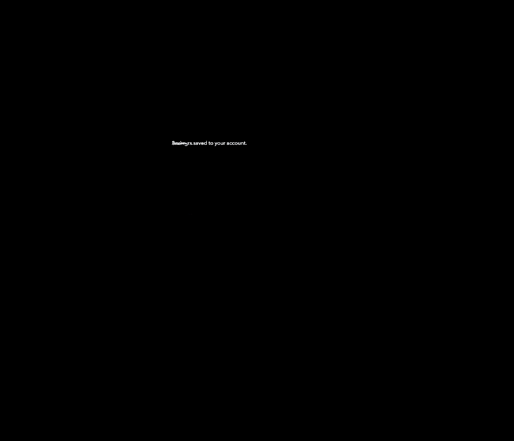

# PR 1162: E2E screenshot diffs

Comparison stage: `pending`. Raw Chromium RGB captures are compared with no masks. PNG compression is lossless; the packed screenshot pixels were checked against their raw captures. Diff images amplify each channel by 5 for visibility.

| Viewport width | Changed pixels | Raw difference bounds (left, top, right, bottom) |
|---|---:|---|
| 1280 px | 901 | (428, 351, 614, 536) |
| 390 px | 918 | (16, 217, 357, 378) |

## Desktop difference

## Phone difference

