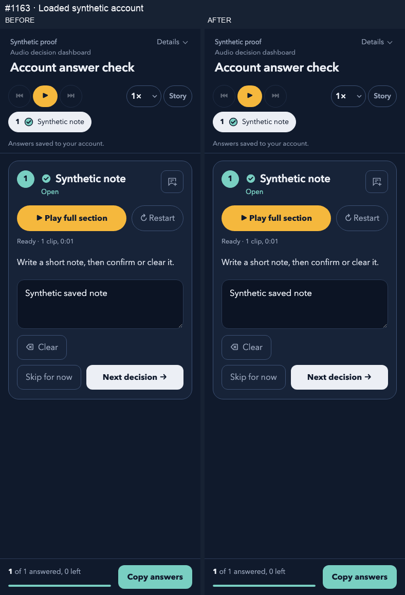

# PR 1163: synthetic Chromium proof

Real Chromium page rendered by the shared decision-flow renderer; isolated synthetic bridge, fake clock and memory-only confirmed-account backend. No real account requests, audio playback or deployment.

Before source commit: `aca880d1f24b1aee9045fecfee0be8fec46b1a47`.
After source commit: `e96f15998194e270d9b8937a33764b109327ebc7` (product code, before adding this proof-only commit).
Renderer SHA-256: `d36bd1a8854a83a1ebec4e9002c724cb8446291a24ad38ee68b4870ebd7d179a`.
Before trimmed installer SHA-256: `0e411b7aec5e4397fb0652a098a9ce0ef0761cff7aa8f690319b35cde66e3385`.
After trimmed installer SHA-256: `fca1d273b76554ad95d0d6c3788086e068107707c5a8e3d50bce87cb8736d6d2`.

The same renderer, synthetic scene and form are used in both arms; only the installer bytes change. Captures use viewport widths 1280 and 390 px, height 1100 px, device scale 1 and reduced motion. All external requests are aborted; no request was made, no page errors occurred, no media played and no horizontal overflow was observed. Owned pages and browser close in finally blocks.

The native Clear button and its confirmation are clicked, then the fake clock advances 11 seconds before reload. Before, the confirmed backend still has the old note; after, the explicit flush confirms its tombstone. Reload creates a fresh fake bridge and loads only the confirmed backend, so before restores the note and after remains empty. This deliberately omits a persistent device journal: it tests account confirmation/fresh-account load, not journal recovery or a production reload guarantee.

| Width | Arm | Stage | Native status label | Textarea | Bridge |
|---|---|---|---|---|---|
| 1280 | before | initial | Answers saved to your account. | Synthetic saved note | Saved |
| 1280 | before | confirmation | Answers saved to your account. | Synthetic saved note | Saved |
| 1280 | before | cleared | Saving… | (empty) | Saving… |
| 1280 | before | reloaded | Answers saved to your account. | Synthetic saved note | Saved |
| 1280 | after | initial | Answers saved to your account. | Synthetic saved note | Saved |
| 1280 | after | confirmation | Answers saved to your account. | Synthetic saved note | Saved |
| 1280 | after | cleared | Answers saved to your account. | (empty) | Saved |
| 1280 | after | reloaded | Answers saved to your account. | (empty) | Saved |
| 390 | before | initial | Answers saved to your account. | Synthetic saved note | Saved |
| 390 | before | confirmation | Answers saved to your account. | Synthetic saved note | Saved |
| 390 | before | cleared | Saving… | (empty) | Saving… |
| 390 | before | reloaded | Answers saved to your account. | Synthetic saved note | Saved |
| 390 | after | initial | Answers saved to your account. | Synthetic saved note | Saved |
| 390 | after | confirmation | Answers saved to your account. | Synthetic saved note | Saved |
| 390 | after | cleared | Answers saved to your account. | (empty) | Saved |
| 390 | after | reloaded | Answers saved to your account. | (empty) | Saved |

The GIF pairs actual 390 px screenshots in event order. The outside headings identify the stage and arms; the UI is not rewritten or composited internally. The timeline is a deterministic checkpoint recording, not a wall-clock latency measurement. PNGs retain original screenshot pixels; GIF uses normal indexed-colour encoding.

See [pixel differences](diffs.md).

## Artifact integrity

| File | Bytes | SHA-256 |
|---|---:|---|
| 1280-after.png | 73362 | `ea60a5ad2a27ba16d598bc88a8542918a3d8643d1fb33c501529afae87cd1d62` |
| 1280-before.png | 72851 | `aa3750b3bb64adaba39d09944ae95950ac3efa62f818e4d5f1fc0c9f835d3e8b` |
| 1280-diff.png | 9296 | `022d104c3d4a3af8be29c13de80ac045c51eb0baeab62fb1c221700c9349687a` |
| 390-after.png | 59066 | `a270f6a12d6b39a47ee1792a2f9ecf8dcae4a77f124340fe4be594650ac1f894` |
| 390-before.png | 58468 | `7fcbe0336e9fb13f0cfaa817526f94bba13d6d3a468f2c2f24d3d7e8969f94d7` |
| 390-diff.png | 6180 | `425283cdec4a155ca47645707aa1de6e6c804812237043dc2b854f7f29666ae5` |
| diffs.md | 605 | `a686631d37f602b9389fc21b79c6e5c084933b1464f88b16351a21696ee2ac1c` |
| interaction.gif | 229614 | `1a70aa5ddc847acd9e52ec75915f05f8983b7edecfe4ab654633c13d2d43fa0d` |
