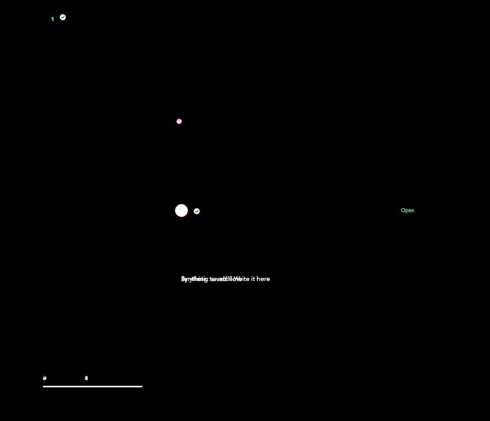
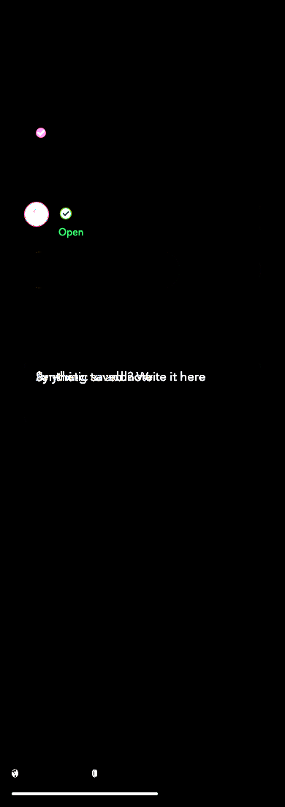

# PR 1163: E2E screenshot diffs

Comparison stage: `reloaded`. Raw Chromium RGB captures are compared with no masks. PNG compression is lossless; the packed screenshot pixels were checked against their raw captures. Diff images amplify each channel by 5 for visibility.

| Viewport width | Changed pixels | Raw difference bounds (left, top, right, bottom) |
|---|---:|---|
| 1280 px | 4809 | (112, 36, 1082, 1012) |
| 390 px | 4373 | (16, 173, 357, 1084) |

## Desktop difference

## Phone difference

